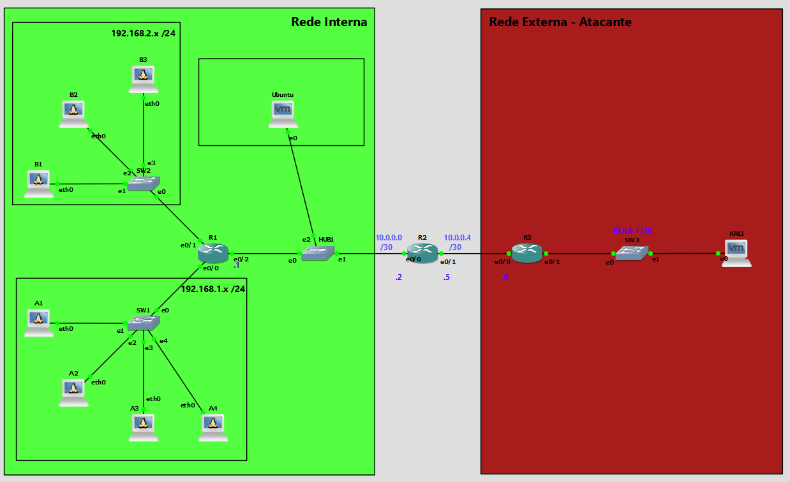

# Suricata: DPI and Lua Scripting

A virtual lab with a Suricata IDS extended with Lua scripts, using Deep Packet Inspection (DPI) to detect threats that static signatures can't catch.
The project was developed for the *Security (Segurança)* course, Computer Engineering degree, ISEC (group project of 3).

## Overview

Static pattern-matching rules are often ineffective against obfuscated traffic or attacks that change dynamically. This project uses Suricata not only as a header validator but as a DPI engine at the application layer (Layer 7), and extends it with Lua scripts to build detection logic with state and deep payload inspection.

The lab was emulated in GNS3, and the detections were validated with attacks launched from a Kali Linux machine.

## Technologies Used

- **Suricata 6.0.20** — IDS / DPI engine
- **Lua** — Custom detection logic
- **GNS3** — Network emulation (Cisco IOU routers)
- **Ubuntu** — Suricata sensor
- **Kali Linux** — Attacker machine

## Lab Architecture



The network is split into three zones:

- **External zone:** attacker (Kali Linux), responsible for injecting malicious payloads.
- **Inspection core:** Ubuntu server running Suricata, connected through an Ethernet hub on the backbone. The hub replicates every packet to the IDS interface without adding load to the routers.
- **Internal zone:** victim machines and a simulated web service on port 80, which creates real TCP flows and HTTP transactions for the DPI.

## Detection Modules

Each Lua script is called from a Suricata rule in `suricata.rules`:

| Module | Script | What it detects |
|--------|--------|-----------------|
| DLP | `dlp_cartao.lua` | Credit card numbers (`XXXX-XXXX-XXXX-XXXX`) in HTTP request bodies |
| Brute force | `forca_bruta_contador.lua` | Repeated failed logins, using a global counter (alert after 3 failures) |
| Offensive tools | `detecao_agente.lua` | Signatures of tools such as `sqlmap`, `nmap` and `nikto` |
| Executable downloads | `bloq_exec.lua` | Requests for `.exe`, `.sh` and `.bat` files |


## Results

The attacks were launched from the Kali machine and each one generated an alert in `fast.log`:

- **DLP:** HTTP POST with a credit card string triggered a Priority 1 alert (SID 100001).
- **Brute force:** three consecutive failed logins triggered the alert (SID 100002).
- **Offensive tools:** traffic with scanner signatures was identified and classified as a web application attack (SID 100003).
- **Executables:** a request for a `.exe` file triggered a policy violation alert (SID 100004).

Suricata ran in IDS mode, so the system detects and alerts but does not block traffic.

## Challenges

- **IP on the monitoring interface:** the sensor was designed to run without an IP address, but real TCP flows were needed for the DPI tests, so a static IP was assigned to the interface.
- **Engine version:** Suricata 8.0.3 was tried first, but the lack of documented Lua examples for the new version led to using 6.0.20, which has much more community support.

## How to Run

1. Install Suricata 6.0.20 on the sensor machine.
2. Copy the Lua scripts to `/etc/suricata/lua/`.
3. Add the rules to `/etc/suricata/rules/suricata.rules`.
4. Start Suricata:
```bash
   sudo suricata -c /etc/suricata/suricata.yaml -S /etc/suricata/rules/suricata.rules -i ens33 -v
```
5. In another terminal, follow the alerts:
```bash
   tail -f /var/log/suricata/fast.log
```
6. Launch the test traffic from the attacker machine.

## Authors

- Gabriel Cardoso Rodrigues
- Artur Meireles de Sousa Falcão
- Rodrigo Trindade Prazeres

ISEC, Instituto Politécnico de Coimbra
